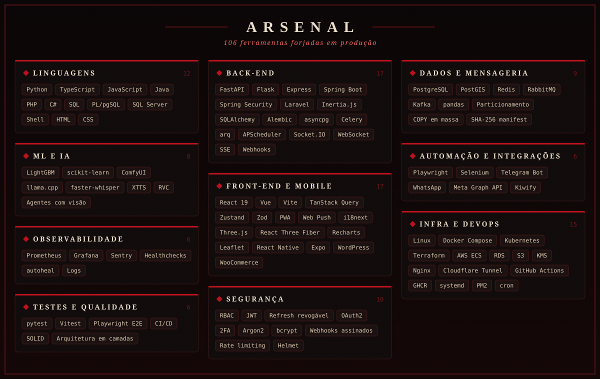

  

  
  
  
  

<table>
<tr>
<td width="38%" align="center" valign="middle">
  
</td>
<td width="62%" valign="top">

### 🏴‍☠️ Sobre o capitão

Construo e opero sistemas de ponta a ponta: coleta, processamento, APIs, interface e infraestrutura.
Hoje respondo por **cerca de 30 sistemas em produção**, com **mais de 160 contêineres em três VPS Linux**.

Nenhum projeto entra no ar sem healthcheck, logs, monitoramento e plano de falha.

### ⚖️ Acusações

- 🏗️ **Arquitetou** APIs assíncronas com RBAC, filas, workers e webhooks com conciliação
- ⚡ **Manteve** pipelines de dados rodando 24/7 com idempotência, backpressure e watchdogs
- 🧠 **Treinou** modelos LightGBM sobre 1,33 milhão de registros e automatizou relatórios regulatórios
- 🤖 **Colocou IA para trabalhar**: imagem e vídeo em GPU, agentes com visão, transcrição e voz
- ☁️ **Domou** 160+ contêineres com Docker, Nginx, Prometheus, Grafana e Terraform na AWS
- 🎨 **Entregou** PWAs, painéis e cenas 3D com React 19, Vue e Three.js
- 🔐 **Blindou** sistemas com JWT revogável, 2FA, Argon2, webhooks assinados e rate limiting

📍 Balneário Camboriú, SC · 🎓 Bacharel em Engenharia de Software · 🗣️ Português, inglês e espanhol

</td>
</tr>
</table>

  

## 💰 Tesouros conquistados

<table>
<tr>
<td width="50%" valign="top">

**🏢 Portal corporativo** 
Sistema central da empresa: RBAC por setor, Kanban, documentos com assinatura, notas fiscais, folha, Web Push e agente de IA. 
FastAPI assíncrono · React · PostgreSQL · Redis · 347 commits · 384 testes

</td>
<td width="50%" valign="top">

**🏠 Avaliação automatizada de imóveis (AVM)** 
1,33 milhão de guias de ITBI reduzidas a 425 mil vendas, modelo LightGBM com perda Huber e relatório regulatório em DOCX e PDF/A. 
Python 3.12 · PostgreSQL 18 · LightGBM · Terraform · AWS

</td>
</tr>
<tr>
<td valign="top">

**⚡ Plataformas de dados em tempo real** 
Proxy WebSocket que enriquece eventos com dados do banco, tabelas particionadas por data e assinaturas por webhook com auditoria. 
Python · Flask · Express · Socket.IO · Redis · Sentry

</td>
<td valign="top">

**📱 Produtos digitais e área de membros** 
PWAs com login, notificações e i18n, acesso liberado por webhook, afiliados e painel administrativo. 
FastAPI · Celery · RabbitMQ · React 19 · Playwright

</td>
</tr>
<tr>
<td valign="top">

**🎬 Geração de imagem e vídeo** 
Versões desktop e web com fila de trabalhos, editor e reconciliação automática, imagens publicadas no GHCR. 
Python · ComfyUI · llama.cpp · Docker · GitHub Actions

</td>
<td valign="top">

**🗺️ Defesa Civil de Balneário Camboriú** 
Mapas de risco e rotas de evacuação, APIs com JWT e OAuth2 e deploy em contêineres. 
Spring Boot · PostGIS · React · Leaflet · Kubernetes

</td>
</tr>
</table>

🔒 A maior parte do que construo é privada, de empresas e clientes. Os repositórios públicos aqui são estudos e projetos pessoais.

  

## 📜 Diário de bordo

  
  

  <picture>
    <source media="(prefers-color-scheme: dark)" srcset="https://raw.githubusercontent.com/RogerAllan/RogerAllan/output/serpente-escura.svg" />
    
  </picture>

🇺🇸 <b>English</b>

 

**Software Engineer · Python Back-end, Full Stack and Infrastructure** · Brazil, open to remote

I build and run systems end to end: data collection, processing, APIs, interfaces and infrastructure.
I'm responsible for about 30 production systems running in more than 160 containers across three Linux servers,
with a focus on continuous ingestion pipelines, PostgreSQL modeling, messaging, application security and observability.
Native Portuguese, advanced English and Spanish.

